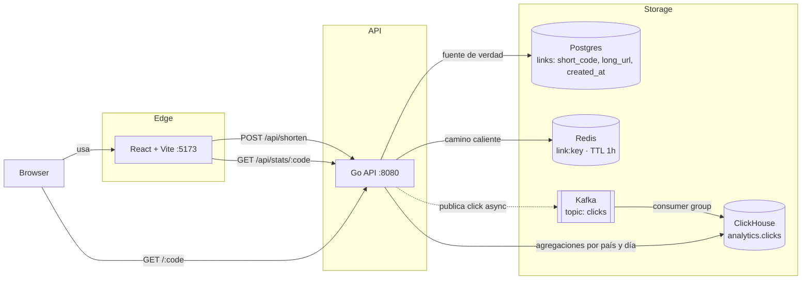

# 0001 — ¿Cómo funciona Bitly?

Ejercicio 0001 de 1024 del curso **¿Cómo funciona...?**. Un ejercicio por semana, en español, con un prototipo funcional que se levanta con una sola orden.

¿Qué pasa entre que pegás una URL larga y aparece un `bit.ly/jzgKpHNqNO`? Este prototipo recorre ese camino completo: genera un ID Snowflake con timestamp, `worker` y secuencia en memoria, lo convierte en base62, guarda el link, redirige desde caché y registra cada click para poder responder después cuántos hubo, de dónde vinieron y en qué día.

## Stack

| Capa | Tecnología | Rol |
| --- | --- | --- |
| Frontend | React + Vite | Cargar URLs, copiar links cortos, ver estadísticas |
| Backend | Go | API HTTP, generación de códigos, redirect, consumer |
| Persistencia | Postgres | Tabla de links (`short_code`, URL original, `created_at`) |
| Caché | Redis | Resolución de keys calientes para redirect |
| Eventos | Kafka | Cola de eventos de click |
| Analíticas | ClickHouse | Agregaciones de clicks por país y por día |
| Infra | Docker Compose | Orquestación local de todos los servicios |

## Arquitectura



Las líneas punteadas son publicaciones asíncronas: el redirect no espera a Kafka ni a ClickHouse. El camino caliente es `GET /:key` → Redis → `302`; ante un miss se consulta Postgres por `short_code` y se repuebla la caché. La persistencia del click la hace el consumer, en otro goroutine.

### Cómo se genera la key

No hay números aleatorios ni hash: la key es un ID Snowflake de 63 bits escrito en base62. El `Generator` de `backend/idgen.go` arma el entero con un mutex; Postgres no interviene en la generación.

```text
[ timestamp 41 bits | worker 10 bits | secuencia 12 bits ]
compositeID = (timestamp << 22) | (worker << 12) | secuencia
key = encodeBase62(compositeID)
```

1. `timestamp = time.Now().UnixMilli() - 1704067200000` → milisegundos desde el epoch `2024-01-01T00:00:00Z`. Cabe en 41 bits.
2. `worker`: viene de la env var `WORKER_ID` (0 a 1023, en local `0`). Cada servidor tiene el suyo y nunca se repite.
3. `secuencia`: contador en memoria de 0 a 4095. Se resetea a 0 en cada milisegundo nuevo; si se llena dentro del mismo ms, el generador espera al siguiente.
4. Ejemplo con `timestamp = 63158400123`, `worker = 0` y `secuencia = 0`: `compositeID = 264905530269499392` → `key = "jzgKpHNqNO"`.
5. `INSERT INTO links (short_code, long_url) VALUES ('jzgKpHNqNO', ...)`. Esa string es la key: `http://localhost:8080/jzgKpHNqNO`.

Si el reloj retrocede, el generador espera a alcanzar el último timestamp usado antes de seguir, para no emitir IDs duplicados. En el redirect se busca directamente `WHERE short_code = <key>`: la key ya identifica al link, no hace falta descomponerla.

### Por qué la key es compuesta

- **No es predecible**: no arranca en 1 ni sigue una secuencia global visible; arranca con el milisegundo actual desde 2024.
- **No necesita secuencia central**: la secuencia vive en memoria del proceso y se reinicia cada milisegundo. La unicidad entre servidores viene del `worker`, que es distinto en cada uno, así que no hay colisiones al agregar más.
- **Queda ordenada por tiempo**: como el timestamp ocupa los 41 bits altos, ordenar los IDs numéricos orderifica los links por fecha de creación. Las keys base62 no conservan ese orden lexicográfico con este alfabeto.

## Cómo correrlo

Requiere Docker con Compose v2 y el daemon corriendo (Docker Desktop o Colima). Una sola orden levanta todo:

```bash
docker compose up
```

Cuando los healthchecks estén verdes:

- Frontend: <http://localhost:5173>
- API: <http://localhost:8080>
- Health: <http://localhost:8080/health>
- ClickHouse HTTP: <http://localhost:8123> (usuario `default`, password `clickhouse`)

Para bajar todo, incluidos los volúmenes:

```bash
docker compose down -v
```

El backend crea las tablas de Postgres y ClickHouse al arrancar (`CREATE TABLE IF NOT EXISTS`), y Kafka tiene la creación automática de topics habilitada. No hay pasos manuales ni migraciones: esta es la primera versión de la app, así que el esquema es directamente `short_code`, `long_url` y `created_at`. En local el `WORKER_ID` es `0`; para correr otro servidor, pasale `WORKER_ID=1` (o el que corresponda) con un valor distinto.

## API

### Acortar una URL

```bash
curl -X POST http://localhost:8080/api/shorten \
  -H 'Content-Type: application/json' \
  -d '{"url":"https://example.com/un/camino/bastante/largo"}'
```

```json
{
  "code": "jzgKpHNqNO",
  "short_url": "http://localhost:8080/jzgKpHNqNO",
  "long_url": "https://example.com/un/camino/bastante/largo"
}
```

`code` es la key base62 y `short_url` es el link corto completo. Cada POST genera un ID Snowflake nuevo, así que la misma URL puede tener varias keys.

### Redirigir

```bash
curl -i http://localhost:8080/jzgKpHNqNO
# HTTP/1.1 302 Found
# Location: https://example.com/un/camino/bastante/largo
```

El país del click se toma de las headers `CF-IPCountry` o `X-Country`; si no están, se registra `XX`. No hay base GeoIP: eso es decisión de alcance, no una limitación técnica del redirect.

### Ver estadísticas

```bash
curl http://localhost:8080/api/stats/jzgKpHNqNO
```

```json
{
  "code": "jzgKpHNqNO",
  "total": 42,
  "by_country": [
    { "country": "AR", "clicks": 30 },
    { "country": "UY", "clicks": 12 }
  ],
  "by_day": [
    { "day": "2026-11-17", "clicks": 42 }
  ]
}
```

### Health

```bash
curl http://localhost:8080/health
# {"status":"ok"}
```

## Alcance y decisiones de diseño

Este es un **ejercicio con alcance deliberado, no un sistema de producción**. Está pensado para explicar el recorrido de una request y las responsabilidades de cada servicio, no para soportar tráfico real ni cumplir requisitos de compliance.

**Las decisiones son intencionales para mantener el ejercicio legible.** Se prefirió un código directo, con pocas abstracciones y dependencias, antes que una arquitectura preparada para escalar. En particular:

- La key es un ID Snowflake (timestamp desde 2024, `worker` y secuencia en memoria) convertido a base62, sin aleatoriedad, hash ni UUID.
- El redirect publica el evento directamente en Kafka, sin outbox ni transacciones coordinadas.
- La entrega es at-least-once: un replay del consumer puede duplicar filas de click, y eso es aceptable para este contador.
- ClickHouse se consulta por su interfaz HTTP con `net/http`, sin un cliente oficial, para que la query sea visible en el código.
- El país se lee de headers en lugar de resolverse con GeoIP.
- Redis y ClickHouse se inicializan con `IF NOT EXISTS` desde el backend; no hay pipeline de migraciones.
- El backend habilita CORS abierto porque el frontend corre en otro puerto durante el desarrollo; en producción se restringiría al origen del frontend.

Las decisiones estructurales están registradas como ADRs en [`docs/adr/`](docs/adr/).

## Por qué esto es simple

Cada punto siguiente es una decisión de diseño explícita para este ejercicio, no una omisión:

- **Reintentos blocking vs. non-blocking complejos:** alcanza con un reintento acotado y backoff exponencial en la publicación y en el insert del consumer. Una cola de reintentos con scheduling dedicado agregaría un subsistema completo sin cambiar lo que acá se demuestra.
- **Dead Letter Topics (DLT):** con un solo topic y un consumer, un mensaje que falla se loguea y se descarta. En producción se derivaría a un DLT para inspección y reprocesamiento; el volumen y la audiencia de este prototipo no justifican ese topic extra.
- **Procesamiento idempotente completo:** los clicks son eventos append-only y el offset se commitea después de insertar, lo que da entrega at-least-once. Duplicados ocasionales no alteran la idea del ejercicio; la deduplicación con claves de idempotencia entra cuando los eventos disparan acciones de negocio.
- **Exactly-once semantics:** no existe un protocolo transaccional conjunto entre Kafka y ClickHouse por HTTP. Lograrlo exigiría un sink con transacciones coordinadas; el prototipo declara at-least-once y construye sus agregaciones sobre esa base.
- **Transactional Outbox Pattern:** si el proceso muere entre el redirect y el publish, se pierde un evento de analítica, nunca el link. El outbox evita esa ventana en producción, pero acá la tabla extra, el poller y el CDC cuestan más complejidad que el problema que resuelven.
- **Monitoreo y recuperación de producción:** el endpoint `/health`, los logs y los healthchecks de Docker Compose cubren la demo. Dashboards, alertas, runbooks y procedimientos de recuperación son capacidades operativas de un sistema real, fuera del alcance de este ejercicio.

## Estructura

```
0001-bitly/
├── README.md
├── docker-compose.yml
├── backend/
│   ├── main.go          # wiring, clientes, router, consumer de Kafka
│   ├── handler.go       # Shorten, Redirect, Stats, Health
│   ├── clickhouse.go    # queries HTTP y writer de eventos
│   └── go.mod
├── frontend/
│   ├── index.html
│   ├── package.json
│   ├── vite.config.ts
│   ├── tsconfig.json
│   └── src/
│       ├── main.tsx
│       ├── App.tsx
│       └── components/StatsPanel.tsx
└── docs/
    └── adr/
        ├── 0001-snowflake-base62.md
        ├── 0002-postgres-como-fuente-de-verdad-y-redis-como-cache.md
        ├── 0003-kafka-para-eventos-de-click.md
        ├── 0004-clickhouse-por-http.md
        └── 0005-pais-desde-headers.md
```

## Objetivos no funcionales declarados

- Redirect con caché por debajo de 50 ms en local.
- Capacidad objetivo de 1000 redirects/segundo en local: el camino caliente es un `GET` a Redis más un `302`.
- Código legible y no sobre-optimizado: la optimización real se mide, se documenta y se aplica cuando el ejercicio lo pide.
